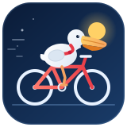
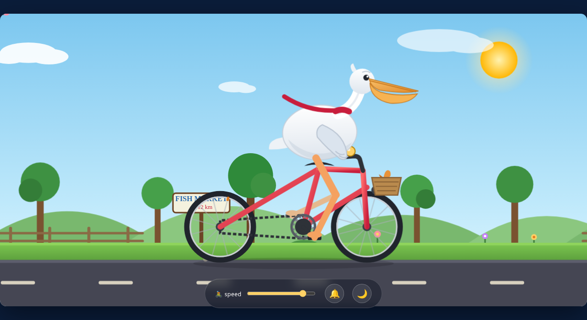
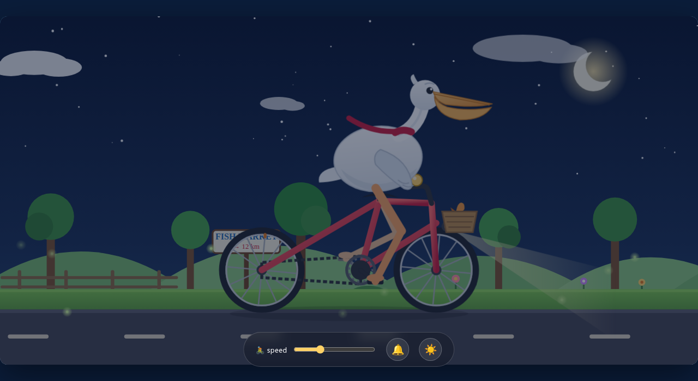
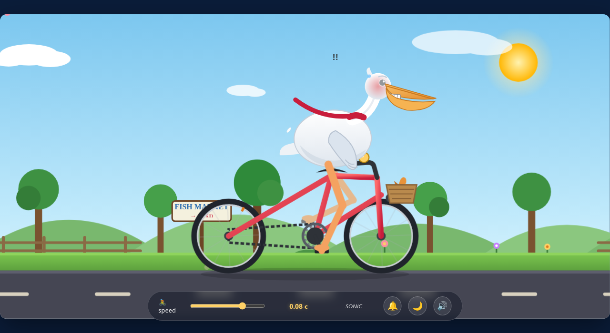
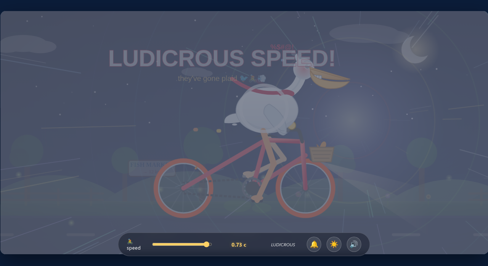

<p align="center">
  
</p>

<p align="center">English · <a href="README.zh-CN.md">简体中文</a></p>

<h1 align="center">Pelican Express</h1>

<p align="center"><strong>One slider, one pelican, one bicycle: ride from a sunny cruise to a night-time warp tunnel.</strong></p>

<p align="center">A single HTML file with a hand-drawn SVG scene, synthesized sound, and no dependencies.</p>



## Quick start

Clone the repo and open `pelican_bike.html` in a modern browser. There is no install step, build step, or server.

```bash
git clone https://github.com/ZisIsNotZis/pelican_bike.git
cd pelican_bike
open pelican_bike.html        # macOS
# xdg-open pelican_bike.html  # Linux
# start pelican_bike.html     # Windows
```

The page runs offline. Audio starts after your first click or key press, as browsers require.

### Controls

| Input | What it does |
| --- | --- |
| Speed slider | Ride through `cruising`, `brisk`, `working hard`, `ALL OUT!!`, `SONIC`, and `LUDICROUS` |
| Click the pelican | Honk |
| Click the bell, or press `B` | Ring the bell |
| Press `N` | Switch between day and night |
| Press `M` | Mute or unmute the wind, rumble, bell, and honk |
| `?speed=85&night=1&instant=1` | Deep-link a speed, start at night, and skip the crossfade |

## What it can do now

- **Six effort stages, one ride.** The speed readout moves from km/h to Mach numbers to fractions of `c` as the scene escalates.
- **A hand-built SVG world.** Four parallax layers, a looping road, clouds, hills, trees, a fish-market sign, and a bicycle whose legs are positioned with inverse kinematics.
- **Day and night.** Stars, moon, headlight beam, and fireflies at night; butterflies and a bright sun by day.
- **Sound tied to the ride.** Wind and rumble are synthesized with the Web Audio API and follow the current speed. The bell and pelican honk are synthesized too.
- **Spectacle at the top end.** Dust, loose feathers, sweat, steam, comic-book effort marks, wheel sparks, speed lines, sonic-boom rings, afterimages, a rainbow trail, a time tunnel, and screen shake.
- **Small surface.** No dependencies, no network requests, no build output. One HTML file you can open years from now.
- **Reduced motion respected.** With `prefers-reduced-motion: reduce`, the page draws a single static frame instead of looping.

| Night ride | Sonic | Ludicrous speed |
| --- | --- | --- |
|  |  |  |

Pre-recorded ride: [assets/pelican_ride.mp4](assets/pelican_ride.mp4).

## Architecture

```text
pelican_bike.html          The whole product: inline CSS, one SVG scene, and one JavaScript file.
record3.js                 Dev-only deterministic recorder (headless Chromium + DevTools).
assets/                    Logo, four preview screenshots, and the recorded ride.
docs/project-status.md     Status and scope of the demo.
LICENSE.md                 AGPL-3.0.
```

Inside `pelican_bike.html`:

- The scene is an SVG with reusable gradients, masks, parallax tiles, and particle pools.
- A single `requestAnimationFrame` loop maps one slider value to stage intensity, world speed, audio, and effects.
- There are no external fonts, images, scripts, or stylesheets. The page is self-contained.

## How to develop

Edit `pelican_bike.html` and refresh the browser. There is no build step and no test suite.

To record a deterministic ride, use the included helper:

```bash
node record3.js 720 frames3 30
```

That writes 720 JPEG frames at 30 fps into `frames3/`. The script expects a Chromium headless shell at the path configured near the top of `record3.js`. `frames*/` is ignored by Git.

## How to contribute

Small fixes and visual polish are welcome through issues and pull requests. For visual changes, attach a screenshot or a short clip. Keep the page to one HTML file with no runtime dependencies; that constraint is the project.

The demo is otherwise closed as a milestone. See [docs/project-status.md](docs/project-status.md).

## Roadmap

### Implemented

- [x] Interactive speed slider with six named effort stages and a live speed readout
- [x] Hand-drawn SVG pelican, bicycle, parallax landscape, and looping road
- [x] Day/night mode with stars, moon, headlight, fireflies, and butterflies
- [x] Synthesized wind, rumble, bell, and honk
- [x] Sonic-boom, time-tunnel, and ludicrous-speed effects
- [x] Keyboard controls, URL deep links, and reduced-motion support
- [x] Deterministic frame recorder and showcase previews
- [x] Zero dependencies and a single-file deployment

### Planned

- [ ] None. The demo is closed as a milestone (2026-09-29).

**Future vision.** Keep Pelican Express as a small, self-contained toy: one file you can open years from now and still ride. If it is ever reopened, the natural direction is more places and weather for the same ride, not more controls or a build system.

## License

[AGPL-3.0](LICENSE.md). The pelican is happy to travel, as long as the source travels with it.
